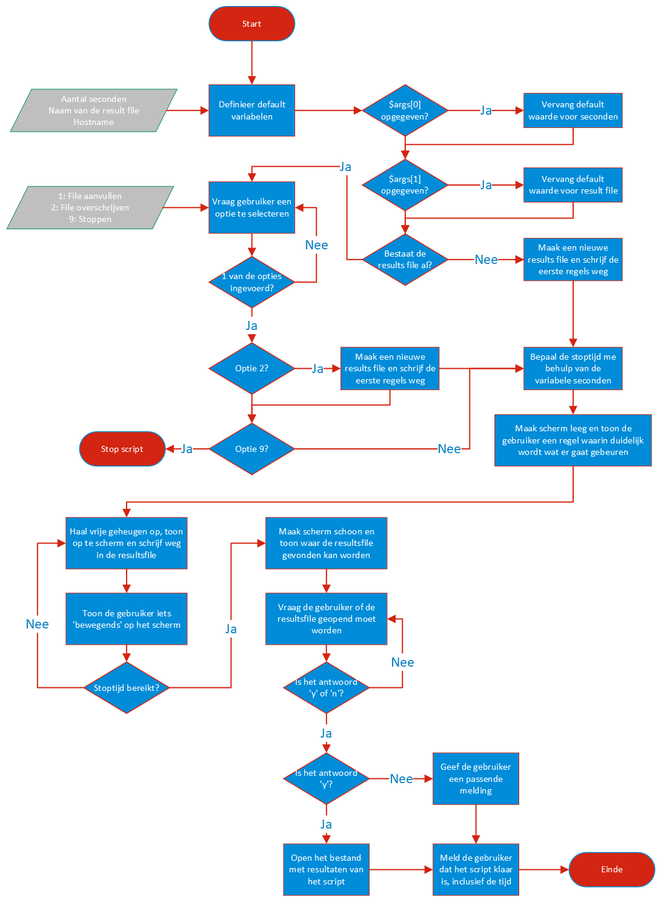

# W1 · Ontwerpt een informatievoorziening: flowchart (9 punten)

**Opdracht (90 min):** maak in **Visio online** een flowchart van het script dat in de opdracht beschreven staat. Zet die daarna in het **Sjabloon ontwerp** (Word) met een toelichting.

| Bestand | Wat |
|---|---|
| **Deze pagina** | Elk Visio-blok uitgelegd, hoe je de tekst schrijft, en de complete flowchart van de oefentoets |
| [ontwerp-sjabloon-ingevuld.md](ontwerp-sjabloon-ingevuld.md) | ⭐ Het **Sjabloon ontwerp volledig ingevuld** voor de Geheugenmonitor (zo goed als overschrijven) |
| [afbeeldingen/flowchart-docent.png](afbeeldingen/flowchart-docent.png) | De officiële uitwerking van de docent |
| [flowchart-kyan-oefentoets.vsdx](flowchart-kyan-oefentoets.vsdx) | Jouw oefenversie (met verbeterpunten [onderaan](#jouw-oefenversie-wat-moet-beter)) |
| [Sjabloon_ontwerp.docx](Sjabloon_ontwerp.docx) | Het lege sjabloon |

## Beoordeling (elk 0-3 punten)
| Criterium | Wat de beoordelaar wil zien | Hoe je dat haalt |
|---|---|---|
| **Beginsituatie** | De relevante eisen en wensen zijn beschreven | Bij *Doel*: een lijstje "het script moet…" (zie sjabloon) |
| **Ontwerp** | Het ontwerp voldoet aan de eisen en wensen | **Elke stap** uit de beschrijving staat in de flowchart, met het **juiste symbool** |
| **Communicatie** | Ontwerp en keuzes zijn begrijpelijk uitgelegd | *Toelichting bij stappen* + *Input/Output data* + *Resultaat uitvoer* in gewone taal |

---

## De blokken in Visio (sjabloon *Basisstroomdiagram* / *Basic Flowchart*)

| Vorm | Naam in Visio (EN / NL) | Wanneer gebruik je hem? | Signaalwoorden in de opdracht | Hoe schrijf je de tekst? | Voorbeeld uit de oefentoets | PowerShell |
|---|---|---|---|---|---|---|
| ⬭ **ovaal** (afgerond) | **Start/End** · *Begin/einde* | Begin en einde van het script. Precies **1× Start**, Einde mag vaker | start, stop het script, klaar | Eén woord | `Start` · `Einde` · `Stop script` | begin bestand · `Exit` |
| ▭ **rechthoek** | **Process** · *Proces* | Het script **doet** iets: variabele vullen, berekenen, scherm leegmaken | vul, zet, bepaal, bereken, vervang, maak leeg | **Werkwoord + wat** (gebiedende wijs) | `Definieer default variabelen` · `Bepaal de stoptijd met behulp van de variabele seconden` · `Vervang default waarde voor seconden` | `$x = …` · `clear` |
| ◇ **ruit** | **Decision** · *Beslissing* | Een **ja/nee-vraag**: een keuze of een lus | controleer of, als, zo ja / zo nee, zolang, net zolang tot | **Korte vraag met ?** | `Aantal seconden als argument opgegeven?` · `Bestaat de results file al?` · `Stoptijd bereikt?` · `Is het antwoord 'y'?` | `if` · `while` |
| ▱ **parallellogram** | **Data** · *Gegevens* (invoer/uitvoer) | **Contact met de gebruiker**: iets vragen of tonen. Ook: welke gegevens er het script in gaan | vraag, toon, meld, geef een melding, voer in | `Vraag …` / `Toon …` / of een lijstje gegevens | `Vraag gebruiker een optie te selecteren` · grijs blok: `1: File aanvullen / 2: File overschrijven / 9: Stoppen` | `Read-Host` · `Write-Host` |
| 🗎 **golvende onderkant** | **Document** · *Document* | Een **bestand** maken, lezen, schrijven of openen | bestand, schrijf weg, maak een bestand, open | `Maak …bestand` / `Schrijf … weg` | `Maak een nieuwe results file en schrijf de eerste regels weg` | `Set-Content` · `Add-Content` · `Invoke-Item` |
| ▭‖ **rechthoek met dubbele zijkanten** | **Subprocess / Predefined process** · *Vooraf gedefinieerd proces* | Een **functie** die ergens anders is uitgewerkt | (functie, subroutine) | Naam van de functie | `Write-Log` | `function …` |
| ⟶ **pijl** | **Dynamic connector** · *Dynamische verbindingslijn* | Volgorde. **Altijd met pijlpunt** | | Bij een ruit: label **Ja** / **Nee** (of 1/2/9) | | |
| ◯ **klein rondje** | **On-page reference** · *Verwijzing op pagina* | Sprong naar een andere plek (A → A) als de tekening te groot wordt | | Een letter: `A`, `B` | | |

> 💡 **Mag je de rechthoek gebruiken voor bestanden?** De docent doet dat zelf (zijn "Maak een nieuwe results file" is een rechthoek). Het Document-symbool is **netter** en laat zien dat je de symbolen kent. Beide worden goedgekeurd. Kies één manier en houd die vol.

> ⚠️ **Die grijze gegevensblokken: geen stap in de flow!**
> Het grijze parallellogram naast `Definieer default variabelen` (en naast de 1/2/9-vraag) is **geen stap**. Er komt dus geen pijl in, en het "start" ook niets. Het is een **toelichting**: *"deze gegevens horen bij dit blok"*. De flow loopt alleen over de hoofdlijn: Start → Definieer default variabelen → …
> Zo'n blok zonder ingaande pijl kan verwarrend zijn. Daarom zijn er twee manieren, en **allebei goed**:
> 1. **Veiligst:** zet de gegevens **in** het blok zelf: `Definieer default variabelen: aantal seconden, naam tekstbestand, hostname`. Je hebt dan geen los blok en geen verwarring.
> 2. **Zoals de docent:** een grijs parallellogram ernaast, met een **stippellijn** (of de Visio-vorm *Annotation*) naar het blok. Dan zie je dat het een toelichting is en geen stap.

> 💡 **Kleuren** maken niet uit. De docent gebruikt blauw met rood, en grijs voor de invoergegevens. Zwart-wit is ook prima.

## Hoe schrijf je de tekst in de blokken? (de 7 regels)
1. **Eén handeling per blok.** "Haal geheugen op, toon en schrijf weg" in één blok mag (de docent doet het), maar drie blokken onder elkaar is duidelijker.
2. **Rechthoek = opdracht** in gebiedende wijs: *Bepaal…*, *Maak…*, *Vervang…*, *Toon…*
3. **Ruit = vraag** met een vraagteken: *Bestaat de results file al?*. **Niet** *Controleer of het bestand bestaat*.
4. **Elke uitgang van een ruit krijgt een label**: Ja/Nee, of de waarde (1, 2, 9).
5. **Gewone taal, geen code.** Schrijf `Aantal seconden als argument opgegeven?` en niet `if ($args[0] -is [int])`. Een variabelenaam erbij mag (`… opgegeven? ($args[0])`), maar is niet nodig. De docent schrijft `$args[0] opgegeven?`, en dat wordt ook goedgekeurd. **Woorden zijn het veiligst:** ook iemand zonder PowerShell-kennis snapt het (criterium *communicatie*).
6. **Volg de beschrijving letterlijk.** Teken wat er staat, niet meer en niet minder.
7. **Lus = terugpijl** naar de plek waar opnieuw gevraagd of gecontroleerd wordt (**niet** naar het begin van het script).

## Van zin naar blok: zo vertaal je de beschrijving
| Zin in de opdracht | Teken je als |
|---|---|
| "Vul drie variabelen met een default waarde: …" | **Proces** `Definieer default variabelen` + (optioneel) **Data** met de drie gegevens ernaast |
| "Controleer of de gebruiker waarden als argument heeft opgegeven… Zo ja, vervang…" | **Ruit** `Aantal seconden als argument opgegeven?` → Ja → **Proces** `Vervang default waarde voor seconden` → terug op de hoofdlijn. Nee → direct door. Daarna een **tweede ruit** `Naam van het bestand als argument opgegeven?` → Ja → `Vervang default waarde voor result file` |
| "Controleer of het tekstbestand al bestaat" | **Ruit** `Bestaat de results file al?` |
| "Zo nee, start een nieuw tekstbestand…" | Nee-tak → **Document** `Maak een nieuwe results file en schrijf de eerste regels weg` |
| "Zo ja, geef de optie aanvullen / overschrijven / stoppen" | Ja-tak → **Data** `Vraag gebruiker een optie te selecteren` (+ grijs Data-blok `1/2/9`) |
| "Vraag net zolang tot een correct antwoord is ingevoerd" | **Ruit** `1 van de opties ingevoerd?` → Nee → **terugpijl naar de vraag** |
| "Als de gebruiker kiest om te overschrijven…" | **Ruit** `Optie 2?` → Ja → **Document** `Maak een nieuwe results file…` |
| (stoppen) | **Ruit** `Optie 9?` → Ja → **Einde** `Stop script` |
| (aanvullen = optie 1) | Nee van `Optie 9?` → door naar de stoptijd |
| "Bepaal de stoptijd en zet deze in een variabele" | **Proces** `Bepaal de stoptijd met behulp van de variabele seconden` |
| "Maak het scherm leeg en toon een melding" | **Proces** `Maak scherm leeg` + **Data** `Toon wat er gaat gebeuren` (of samen in één blok, zoals de docent) |
| "Zolang de stoptijd nog niet bereikt is: …" | blokken van de lus → **Ruit** `Stoptijd bereikt?` → Nee → **terugpijl naar het eerste blok van de lus** · Ja → verder |
| "check het vrije geheugen, toon op het scherm en schrijf weg" | **Proces** `Haal vrije geheugen op` → **Data** `Toon op scherm` → **Document** `Schrijf weg in de results file` |
| "toon de gebruiker iets 'bewegends'" | **Data** `Toon de gebruiker iets 'bewegends'` |
| "Maak het scherm leeg en toon waar het bestand staat" | **Proces/Data** `Maak scherm schoon en toon waar de results file staat` |
| "Vraag of de gebruiker het bestand wil openen. Herhaal net zolang tot y of n" | **Data** `Vraag of de results file geopend moet worden` → **Ruit** `Is het antwoord 'y' of 'n'?` → Nee → terug naar de vraag |
| "Als het antwoord y is: open het bestand" | **Ruit** `Is het antwoord 'y'?` → Ja → **Document** `Open het bestand` |
| "Als het antwoord n is: geef een passende melding" | Nee → **Data** `Geef de gebruiker een passende melding` |
| "Meld de gebruiker dat het script klaar is, inclusief de tijd" | **Data** `Meld dat het script klaar is, inclusief de tijd` → **Einde** |

### while of do-until: waar staat de ruit?
- **"Zolang …"**, eerst controleren (`while`): de ruit staat **boven** het blok.
- **"Net zolang tot …"**, eerst doen (`do…until`): de ruit staat **onder** het blok.

De docent tekent de meetlus met de ruit **onder** de blokken (eerst meten, dan "Stoptijd bereikt?"). Beide worden goedgekeurd, zolang de terugpijl klopt.

---

## De complete flowchart van de oefentoets
Zo ziet de uitwerking van de docent eruit (GitHub tekent dit diagram automatisch). De twee argument-ruiten staan hier in **gewone woorden**. De docent schrijft `$args[0] opgegeven?` en `$args[1] opgegeven?`. Allebei goed.

```mermaid
flowchart TD
    S([Start]) --> P1[Definieer default variabelen]
    D0[/Aantal seconden<br>Naam van de result file<br>Hostname/] -.-> P1
    P1 --> Q1{"Aantal seconden als<br>argument opgegeven?"}
    Q1 -- Ja --> P2[Vervang default waarde voor seconden] --> Q2
    Q1 -- Nee --> Q2{"Naam van het bestand als<br>argument opgegeven?"}
    Q2 -- Ja --> P3[Vervang default waarde voor result file] --> Q3
    Q2 -- Nee --> Q3{Bestaat de results file al?}
    Q3 -- Nee --> F1[Maak een nieuwe results file en schrijf de eerste regels weg]
    Q3 -- Ja --> V1[/Vraag gebruiker een optie te selecteren/]
    D1[/1: File aanvullen<br>2: File overschrijven<br>9: Stoppen/] -.-> V1
    V1 --> Q4{1 van de opties ingevoerd?}
    Q4 -- Nee --> V1
    Q4 -- Ja --> Q5{Optie 2?}
    Q5 -- Ja --> F2[Maak een nieuwe results file en schrijf de eerste regels weg] --> T1
    Q5 -- Nee --> Q6{Optie 9?}
    Q6 -- Ja --> E1([Stop script])
    Q6 -- Nee --> T1
    F1 --> T1[Bepaal de stoptijd met behulp van de variabele seconden]
    T1 --> M1[Maak scherm leeg en toon de gebruiker wat er gaat gebeuren]
    M1 --> L1[Haal vrije geheugen op, toon op scherm en schrijf weg in de results file]
    L1 --> L2[/Toon de gebruiker iets 'bewegends' op het scherm/]
    L2 --> Q7{Stoptijd bereikt?}
    Q7 -- Nee --> L1
    Q7 -- Ja --> R1[Maak scherm schoon en toon waar de results file gevonden kan worden]
    R1 --> V2[/Vraag de gebruiker of de results file geopend moet worden/]
    V2 --> Q8{Is het antwoord 'y' of 'n'?}
    Q8 -- Nee --> V2
    Q8 -- Ja --> Q9{Is het antwoord 'y'?}
    Q9 -- Ja --> O1[Open het bestand met resultaten]
    Q9 -- Nee --> O2[/Geef de gebruiker een passende melding/]
    O1 --> K1[/Meld de gebruiker dat het script klaar is, inclusief de tijd/]
    O2 --> K1
    K1 --> E2([Einde])
    classDef info fill:#ddd,stroke:#999,color:#333
    class D0,D1 info
```

Het origineel van de docent:

---

## Visio online: zo werk je snel
1. Ga naar [office.com/launch/visio](https://www.office.com/launch/visio) → **Basic Flowchart** (Basisstroomdiagram).
2. **Sleep** een vorm op het canvas en **typ** meteen de tekst.
3. **Snel verbinden:** ga met je muis over een vorm, klik op het **blauwe pijltje** en kies de volgende vorm. Dan heb je meteen een pijl.
4. **Vastlijmen:** laat een pijl los **op** de vorm (die licht op). Dan schuift de pijl mee. Losse pijlen = puntaftrek.
5. **Ja/Nee bij een pijl:** klik op de lijn en typ.
6. **Terugpijl (lus):** sleep een verbindingslijn van de ruit naar het blok waar je opnieuw begint.
7. **Netjes:** selecteer meerdere vormen → **Arrange → Align** (Uitlijnen). Houd de hoofdlijn recht van boven naar beneden.
8. **Naar Word:** selecteer alles (Ctrl+A) → kopiëren → plakken in het sjabloon. Of maak een screenshot (Win+Shift+S).

## Checklist voor je inlevert
- [ ] Precies één **Start**; elk pad eindigt bij een **Einde** (`Stop script` telt ook)
- [ ] **Elke stap** (1 t/m 9) uit de beschrijving is terug te vinden
- [ ] Juiste symbool per stap (vraag/toon = parallellogram, bestand = document, keuze = ruit)
- [ ] Elke ruit is een **vraag met ?** en elke uitgang heeft een **label**
- [ ] Keuze **aanvullen / overschrijven / stoppen** heeft **drie** uitkomsten
- [ ] Beide invoerlussen (1/2/9 en y/n) hebben een **terugpijl naar de vraag**
- [ ] De meetlus heeft een **terugpijl** en kan **eindigen** (Stoptijd bereikt? → Ja)
- [ ] Na "Open bestand" loopt een pijl door (**geen doodlopend pad**)
- [ ] Alle pijlen hebben een pijlpunt en zitten **vast**
- [ ] Geen code in de blokken, geen kruisende lijnen
- [ ] **Droog gedraaid:** (a) geen argumenten + bestand bestaat niet, (b) bestand bestaat + "x" + "2", (c) keuze 9

---

## Jouw oefenversie: wat moet beter?
Je [Visio-bestand](flowchart-kyan-oefentoets.vsdx) vergeleken met de docent:

| # | Probleem | Oplossing |
|---|---|---|
| 1 | **Keuze? heeft maar 2 uitgangen** (overschrijven / stop). *Aanvullen* ontbreekt | Twee ruiten zoals de docent: `Optie 2?` → `Optie 9?` → Nee = aanvullen → door naar stoptijd |
| 2 | Vraagtekst *"Tekstbestand overschrijven?"* | `Vraag gebruiker een optie te selecteren` + grijs blok `1: aanvullen / 2: overschrijven / 9: stoppen` |
| 3 | **"Open Bestand" heeft geen uitgaande pijl** (doodlopend pad) | Pijl naar `Meld … klaar + tijd` |
| 4 | Terugpijl van "Toont iets bewegends" en de pijl uit "Vervang…" zitten **niet vast** | Opnieuw vastlijmen |
| 5 | Ruiten als opdracht: *"Controleer of tekstbestand al bestaat"* | Als vraag: `Bestaat de results file al?` |
| 6 | Argumenten in één ruit | Splits in twee vragen zoals de beschrijving: `Aantal seconden als argument opgegeven?` en `Naam van het bestand als argument opgegeven?` |
| 7 | Drie losse blokken met code (`$bestandsnaam = "MemoryUsage.txt"`) | Eén blok `Definieer default variabelen: aantal seconden, naam tekstbestand, hostname` (of grijs toelichtingsblok ernaast, zie de ⚠️ hierboven) |

✅ **Wat al goed was:** volgorde, stoptijd vóór de lus, beide invoerlussen met terugpijl naar de vraag, Ja/Nee-labels, twee Eindes, "bewegend" in de lus.
